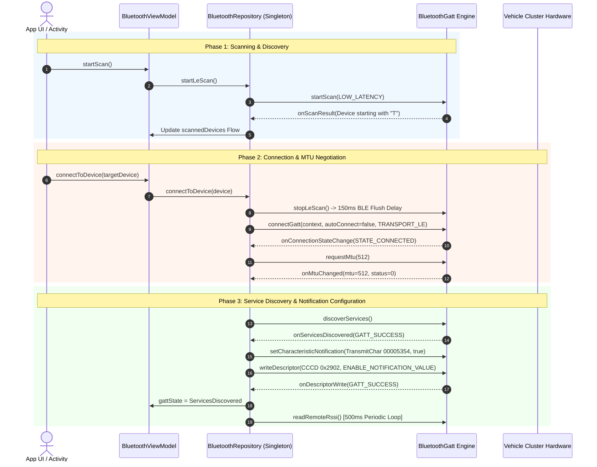

# Vehicle Telemetry & Payload SDK (`:protolib`)

## Technical Engineering Manual & BLE Protocol Reference

> [!IMPORTANT]
> This document provides comprehensive engineering specifications covering **BLE Service/Characteristic UUIDs**, **Connection Sequences**, **GATT Read/Write Data Flows**, **ACK/Response Mechanisms**, **GATT Error Code References**, and **Protobuf Envelope Schemas** for the `:protolib` SDK.

---

## 📋 Table of Contents
1. [BLE GATT Architecture & UUID Specifications](#1-ble-gatt-architecture--uuid-specifications)
2. [Connection Sequence & Lifecycle Management](#2-connection-sequence--lifecycle-management)
3. [Detailed BLE Read & Write Data Flow](#3-detailed-ble-read--write-data-flow)
   - [A. Outbound Write Data Flow (App -> Vehicle)](#a-outbound-write-data-flow-app---vehicle)
   - [B. Inbound Read/Notification Data Flow (Vehicle -> App)](#b-inbound-readnotification-data-flow-vehicle---app)
4. [ACK & Response Mechanism](#4-ack--response-mechanism)
5. [GATT Status Error Codes Reference Table](#5-gatt-status-error-codes-reference-table)
6. [Unified Envelope Architecture (`VehicleMessage`)](#6-unified-envelope-architecture-vehiclemessage)
7. [Core API Usage & Method Signatures](#7-core-api-usage--method-signatures)
8. [Complete Protobuf Schema Specification (`vehicle.proto`)](#8-complete-protobuf-schema-specification-vehicleproto)
9. [Telemetry Data Fields & Formatted UI Helpers](#9-telemetry-data-fields--formatted-ui-helpers)
10. [SDK Security & Obfuscation](#10-sdk-security--obfuscation)

---

## 1. BLE GATT Architecture & UUID Specifications

The application communicates with the vehicle cluster via custom BLE GATT services and characteristics:

| Component Name | UUID String | GATT Properties | Function / Purpose |
| :--- | :--- | :--- | :--- |
| **Custom Primary Service** | `5456534d-5647-5341-5342-454e544f5251` | Primary | Main TVS Vehicle Cluster Service |
| **Transmit Characteristic** | `00005354-0000-1000-8000-00805f9b34fb` | Read, Notify | **Inbound Data (Vehicle -> App)**: Sends telemetry notifications (`VehicleMessage`) to the app. |
| **Receive Characteristic** | `00005352-0000-1000-8000-00805f9b34fb` | Write, Write No Response | **Outbound Data (App -> Vehicle)**: Accepts commands, credentials (`UserData`), and passcodes (`PassCode`). |
| **CCCD Descriptor** | `00002902-0000-1000-8000-00805f9b34fb` | Read, Write | **Client Characteristic Configuration**: Enables notifications on characteristic `00005354`. |

---

## 2. Connection Sequence & Lifecycle Management



---

## 3. Detailed BLE Read & Write Data Flow

### A. Outbound Write Data Flow (App -> Vehicle)

```
[ App UI Input ] (e.g. Username & Password / Passcode)
      │
      ▼
[ VehicleSDK ] (encodeUserData / encodePassCode)
      │
      ▼ (Wraps in VehicleMessage Envelope & converts to ByteArray)
[ BluetoothRepository.sendCommand(data) ]
      │
      ▼ (Checks GATT State & Inspects Characteristic Properties)
[ Select Write Type ] (WRITE_TYPE_NO_RESPONSE vs WRITE_TYPE_DEFAULT)
      │
      ▼ (Payload MTU Check <= 512 bytes)
[ BluetoothGatt.writeCharacteristic(ReceiveChar 00005352, data) ]
      │
      ▼
[ BluetoothGattCallback.onCharacteristicWrite(status) ]
      │
      ▼ (If status == GATT_SUCCESS)
[ BleWriteResult.Success ] -> UI Success Toast & Log Output
```

#### Step-by-Step Outbound Pipeline:
1. **Serialization**: `VehicleSDK.getInstance().encodeUserData(username, password)` constructs `VehicleProto.UserData`, wraps it in `VehicleProto.VehicleMessage` envelope, and serializes to `ByteArray`.
2. **Property Resolution**: `BluetoothRepository.sendCommand(data)` checks `CHARACTERISTIC_RECEIVE_UUID` properties to select `WRITE_TYPE_NO_RESPONSE` or `WRITE_TYPE_DEFAULT`.
3. **Transmission**: Invokes `gatt.writeCharacteristic(characteristic, data, writeType)`.
4. **Result Verification**: Returns `BleWriteResult.Success` or `BleWriteResult.Error(reason)` with diagnostic details.

---

### B. Inbound Read/Notification Data Flow (Vehicle -> App)

```
[ Vehicle MCU / CAN Bus Sensors ] (Battery, RPM, Speed, Fuel, Tyres...)
      │
      ▼
[ Encode VehicleHealth ] (Wrapped in VehicleMessage Envelope)
      │
      ▼
[ BLE Notification ] (Fired on Transmit Characteristic 00005354)
      │
      ▼
[ BluetoothGattCallback.onCharacteristicChanged(value: ByteArray) ]
      │
      ▼
[ VehicleSDK.getInstance().processRawData(value) ]
      │
      ▼ (Parse VehicleMessage -> Extract VehicleHealth -> Map to VehicleTelemetry)
[ MutableStateFlow<VehicleTelemetry>._telemetry.value = updatedTelemetry ]
      │
      ▼
[ UI Dashboard Observers ] (Triggers instant UI refresh via StateFlow)
```

---

## 4. ACK & Response Mechanism

To ensure reliability across noisy wireless environments, two levels of ACKs are implemented:

1. **Low-Level Transport ACK (GATT Transport)**:
   - When sending with `WRITE_TYPE_DEFAULT`, Android receives a low-level ATT Write Response from the peripheral, triggering `BluetoothGattCallback.onCharacteristicWrite(gatt, characteristic, status)` with `status = 0 (GATT_SUCCESS)`.

2. **Application-Level ACK (Payload Protocol)**:
   - Upon receiving and decoding a `VehicleMessage` envelope (`UserData` / `PassCode`), the vehicle cluster sends an application-level response notification back on characteristic `00005354`.
   - `VehicleSDK.getInstance().processRawData(value)` parses the response packet and updates the connection/status log.

---

## 5. GATT Status Error Codes Reference Table

| Error Code (Hex / Dec) | Status Name | Root Cause | SDK Self-Healing Mitigation |
| :--- | :--- | :--- | :--- |
| **`0x00` (0)** | `GATT_SUCCESS` | Operation completed successfully. | Normal operation. |
| **`0x85` (133)** | `GATT_ERROR` | BLE stack race condition caused by rapid connection right after scan without delay, or stale GATT table. | **150ms Scan Flush Delay**: Adds 150ms delay between `stopLeScan()` and `connectGatt()`, using `TRANSPORT_LE` explicitly. |
| **`0x08` (8)** | `GATT_CONN_TIMEOUT` | Connection supervision timeout; keyfob out of range (> 6.0m) or powered down. | **12s Timeout Handler**: Automatically closes GATT instance, clears state, and notifies UI. |
| **`0x13` (19)** | `GATT_CONN_TERMINATE_PEER_USER` | Link terminated by peripheral keyfob. | Flushes `VehicleSDK.getInstance().reset()` and cleans up resources. |
| **`0x80` (128)** | `GATT_WRITE_NOT_PERMITTED` | Attempted write on a characteristic without write properties, or incorrect write type. | **Auto Write-Type Fallback**: Tries `WRITE_TYPE_NO_RESPONSE` first; if rejected, automatically retries with `WRITE_TYPE_DEFAULT`. |
| **`0x0D` (13)** | `GATT_INVALID_ATTRIBUTE_LENGTH` | Payload size exceeds characteristic attribute length or MTU limit. | **MTU Negotiation**: Requests 512-byte ATT MTU upon connection (`gatt.requestMtu(512)`). |

---

## 6. Unified Envelope Architecture (`VehicleMessage`)

All transport payloads are wrapped inside a unified transport-level envelope: `VehicleMessage`.

```
VehicleMessage (envelope)
 └── oneof payload {
       ├── Tag 1: VehicleHealth (Sensor telemetry: battery, speed, RPM, fuel, tyres...)
       ├── Tag 2: UserData      (User credentials: username max 32, password 8-32)
       └── Tag 3: PassCode      (4-digit security code)
     }
```

---

## 7. Core API Usage & Method Signatures

### A. Processing Incoming BLE Telemetry Data
```kotlin
import com.deepak.protolib.VehicleSDK

// In your BluetoothGattCallback
override fun onCharacteristicChanged(
    gatt: BluetoothGatt,
    characteristic: BluetoothGattCharacteristic,
    value: ByteArray
) {
    // Decodes raw BLE notification bytes and updates telemetry StateFlow
    VehicleSDK.getInstance().processRawData(value)
}
```

---

### B. Observing Telemetry Updates in UI (`StateFlow`)
```kotlin
import androidx.lifecycle.lifecycleScope
import androidx.lifecycle.repeatOnLifecycle
import com.deepak.protolib.VehicleSDK
import kotlinx.coroutines.launch

class TelemetryDashboardActivity : AppCompatActivity() {

    override fun onCreate(savedInstanceState: Bundle?) {
        super.onCreate(savedInstanceState)
        setContentView(R.layout.activity_telemetry)

        lifecycleScope.launch {
            repeatOnLifecycle(Lifecycle.State.STARTED) {
                VehicleSDK.getInstance().telemetry.collect { data ->
                    // Formatted UI Helper Strings (1 decimal place)
                    binding.tvBattery.text = "${data.batteryVoltageDisplay} V"
                    binding.tvThrottle.text = "${data.throttlePositionDisplay} %"
                    binding.tvFrontTyre.text = "${data.tyrePressureFrontDisplay} PSI"

                    // Raw sensor values
                    binding.tvSpeed.text = "${data.wheelSpeedKmh} km/h"
                    binding.tvRpm.text = "${data.engineSpeedRpm} RPM"
                    binding.tvFuel.text = "${data.fuelLevelPct} %"
                    binding.tvGear.text = if (data.gearPosition == 0) "N" else data.gearPosition.toString()
                }
            }
        }
    }
}
```

---

### C. Encoding User Credentials (`UserData`)
```kotlin
import com.deepak.protolib.VehicleSDK

fun sendUserCredentials(usernameInput: String, passwordInput: String) {
    // High-level SDK encoding API
    val serializedBytes: ByteArray = VehicleSDK.getInstance().encodeUserData(
        username = usernameInput,  // Max 32 chars
        password = passwordInput   // 8 to 32 chars
    )

    // Transmit via BLE Receive Characteristic (00005352)
    bluetoothRepository.sendCommand(serializedBytes)
}
```

---

### D. Encoding 4-Digit Passcode (`PassCode`)
```kotlin
import com.deepak.protolib.VehicleSDK

fun sendPasscode(passCodeString: String) {
    // High-level SDK encoding API for 4-digit passcode
    val serializedBytes: ByteArray = VehicleSDK.getInstance().encodePassCode("1234")

    // Transmit via BLE Receive Characteristic (00005352)
    bluetoothRepository.sendCommand(serializedBytes)
}
```

---

## 8. Complete Protobuf Schema Specification (`vehicle.proto`)

```protobuf
syntax = "proto3";

package vehicle;

option java_package = "com.deepak.protolib";
option java_outer_classname = "VehicleProto";

// Sensor values reported by the vehicle.
message VehicleHealth {
  float battery_voltage = 1;         // Volts (e.g. 12.6)
  uint32 engine_temp_celsius = 2;    // °C
  uint32 engine_speed_rpm = 3;       // RPM
  float throttle_position_pct = 4;   // 0.0 to 100.0 %
  float intake_air_temp_celsius = 5; // °C
  bool mil_on = 6;                   // Check Engine Light
  bool abs_warning = 7;              // ABS Warning
  uint32 fuel_level = 8;             // 0 to 100 %
  uint32 wheel_speed_kmh = 9;        // km/h
  uint32 gear_position = 10;         // 0=Neutral, 1-6
  bool can_status_ok = 11;           // CAN Bus Status
  bool side_stand_down = 12;         // Side Stand Deployed
  bool isg_active = 13;              // ISG System Status
  float tyre_pressure_front_psi = 14;// PSI
  float tyre_pressure_rear_psi = 15; // PSI
}

// User credentials (Username max 32 chars, Password 8-32 chars).
message UserData {
  string username = 1;
  string password = 2;
}

// Four-digit passcode, represented as individual digits.
message PassCode {
  uint32 digit1 = 1;
  uint32 digit2 = 2;
  uint32 digit3 = 3;
  uint32 digit4 = 4;
}

// Common transport-level wrapper envelope for all application payloads.
message VehicleMessage {
  oneof payload {
    VehicleHealth vehicle_health = 1;
    UserData user_data = 2;
    PassCode pass_code = 3;
  }
}
```

---

## 9. Telemetry Data Fields & Formatted UI Helpers

| Field Name | Type | Description | Display Helper Property | Example Output |
| :--- | :--- | :--- | :--- | :--- |
| `batteryVoltage` | `Float` | Battery Voltage (V) | `batteryVoltageDisplay` | `"12.6"` |
| `engineTempCelsius` | `Int` | Engine Temp (°C) | -- | `85` |
| `engineSpeedRpm` | `Int` | Engine Speed (RPM) | -- | `3500` |
| `throttlePositionPct`| `Float` | Throttle Position (0-100%) | `throttlePositionDisplay` | `"15.5"` |
| `intakeAirTempCelsius`| `Float` | Intake Air Temp (°C) | `intakeAirTempDisplay` | `"24.0"` |
| `milOn` | `Boolean` | Check Engine Light | -- | `true / false` |
| `absWarning` | `Boolean` | ABS Warning | -- | `true / false` |
| `fuelLevelPct` | `Int` | Fuel Level (0-100%) | -- | `80` |
| `wheelSpeedKmh` | `Int` | Speed in km/h | -- | `60` |
| `gearPosition` | `Int` | 0=Neutral, 1-6=Gears | -- | `0, 1, 2...` |
| `canStatusOk` | `Boolean` | CAN Bus Status | -- | `true / false` |
| `sideStandDown` | `Boolean` | Side Stand Deployed | -- | `true / false` |
| `isgActive` | `Boolean` | ISG System Status | -- | `true / false` |
| `tyrePressureFrontPsi`| `Float` | Front Tyre Pressure (PSI) | `tyrePressureFrontDisplay` | `"32.5"` |
| `tyrePressureRearPsi` | `Float` | Rear Tyre Pressure (PSI) | `tyrePressureRearDisplay` | `"36.0"` |

---

## 10. SDK Security & Obfuscation

The `:protolib` release artifact (`protolib-release.aar`) is protected using **R8 Minification and Code Obfuscation** (`isMinifyEnabled = true`):

- **Symbol Protection**: All internal classes, fields, methods, and Protobuf generated code are obfuscated into unreadable single-letter symbols (`a.b.c`).
- **Internal Repackaging**: Internal classes are repackaged into `-repackageclasses 'com.deepak.protolib.internal'`.
- **Debug Stripping**: Local variable tables, source file names, and line debug attributes are stripped.
- **Consumer Rules**: Consumer applications automatically inherit [`consumer-rules.pro`](consumer-rules.pro) preserving only public SDK interfaces (`VehicleSDK`, `VehicleTelemetry`).
